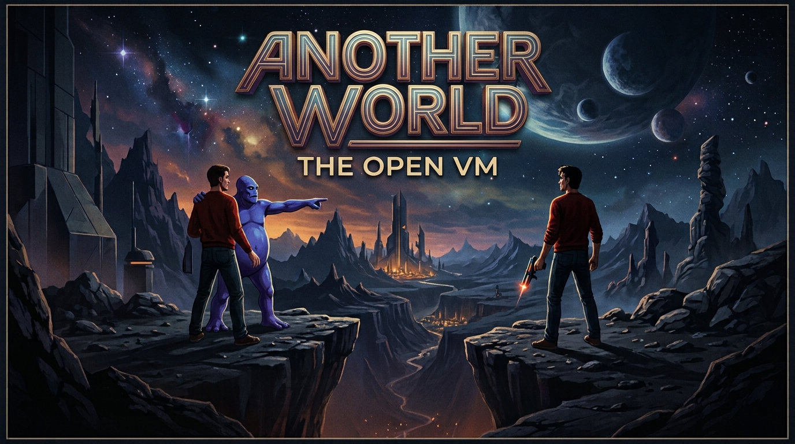

# Another World — The Open VM

*A mobile-first web port of Éric Chahi's 1991 classic, running on its original virtual machine.*

## Why this exists

I recently went to **Codemotion** and sat in on a talk by **Francesco Sciuti** that walked through how the
virtual machine behind *Another World* actually works. That game was a big part of my childhood, and somewhere
between the slides on bytecode and polygons one thought took over: *I want to play this again, on my phone.*

I looked for a web version that works well on mobile and couldn't find one. And we live in a time where
writing an emulator, starting from knowledge that people generously shared, and with an AI agent as a pair
programmer, goes at a ridiculous speed. So I couldn't not do it: a web port with a UX designed for touch screens,
as a small tribute to a truly noble game.

Huge thanks to Éric Chahi for the game, to Francesco for the spark, and to everyone who documented and
re-implemented this VM before me (see [Credits](#credits-and-license)). If you played it as a kid too, I hope
this brings back a little of that feeling. Issues and pull requests are very welcome.

## What it is

A JavaScript port of the **Another World** (*Out of This World*) virtual machine.
It runs the original game's bytecode in the browser: HTML canvas for video, Web Audio for sound and music,
touch controls for phones and tablets, keyboard and gamepad on desktop. No build step, no dependencies.

> **The game data is not included.** Another World is still commercially available; this repository only
> contains the interpreter. You can either:
> - **use the hosted page**: on first launch it asks for a **`.zip`** with the files of *your own* copy
>   (DOS version: `memlist.bin` and `bank01` … `bank0d`, in the root or in any folder of the zip). They are stored in
>   your browser's IndexedDB and never uploaded; or
> - **download the project and run it** (`./run.sh`, or any static server), putting the files in `game/`.

## Playing

- **Touch**: virtual pad on the left (up = jump, down = crouch), action button on the right (run / fire / kick).
  The ☰ button opens the menu (save/load slots, password entry, fullscreen, mute).
  Landscape is recommended. On iOS/Android use "Add to Home Screen" to install it as a fullscreen app.
- **Keyboard**: arrows or WASD to move, Space / Enter / Z / X for the action button, Esc or P for the menu,
  F5 / F9 quick save / load.
- **Gamepad**: d-pad or left stick, any face button for the action button.
- **Password screen**: menu → *Inserisci codice*. Type the 4 letters, confirm with Enter or the action button.
  The copy-protection code wheel is skipped.

## Run locally

```sh
./run.sh                        # starts a local server and opens the browser (./run.sh 9000 for another port)
# or: python3 -m http.server 8000   (any static server works; ES modules need http(s), not file://)
```

Open <http://localhost:8000>. Put the game files (`memlist.bin`, `bank01` … `bank0d`) in `game/`: they are picked up
automatically and the folder content is git-ignored. Without them the game asks you to select the files.

## Publish on GitHub Pages

Push to `main` and enable **Settings → Pages → Source: GitHub Actions** (a workflow is included),
or serve the branch root directly. The game data is git-ignored, so players always bring their own files.

## Translations

The interface is translated into English, Italian, French, German, Spanish, Portuguese, Dutch, Polish, Russian,
Turkish, Japanese, Korean and Chinese. The language is picked from the browser settings and can be changed from the
pause menu. English is the fallback: any missing key or unknown language shows the English text.

To add a language:

1. copy `i18n/en.json` to `i18n/<code>.json` (e.g. `sv.json`) and translate the values; keep the keys and the
   `{placeholders}` (like `{slot}`, `{count}`, `{files}`) untouched;
2. add `"<code>": "Native name"` to `i18n/languages.json`;
3. optionally run `node tools/check-i18n.mjs` to see missing keys or broken placeholders.

The pixel font only covers Latin characters; other scripts use the system font. The game's own in-game text is
part of the original data and is not translated.

## How it works

| File | Role |
| --- | --- |
| `src/bank.js` | Decompressor for the game's packed resources |
| `src/resource.js` | `memlist.bin` directory, loading of resources and game parts |
| `src/vm.js` | The bytecode VM: 64 cooperative threads, 27 opcodes, polygon draw opcodes |
| `src/video.js` | 4 × 320×200 4-bit pages, polygon rasteriser, font, palette handling |
| `src/mixer.js` | 4-channel 8-bit mixer and the music sequencer (sample-accurate) |
| `src/engine.js` | Glue + save states |
| `src/i18n.js` | Translation loader (`i18n/*.json`) |
| `src/web.js` | Browser layer: canvas, input, Web Audio, storage, menu |

The VM yields at every frame blit so the browser's `requestAnimationFrame` loop paces the game
(the script asks for N × 20 ms per frame) instead of blocking.

`tools/headless.mjs` runs the VM under Node and dumps frames as PNG, handy to test without a browser:
`node tools/headless.mjs game /tmp/frames 3000 500`.

## Credits and license

The VM design follows the work of Gregory Montoir (*Raw*) and Fabien Sanglard
([Another-World-Bytecode-Interpreter](https://github.com/fabiensanglard/Another-World-Bytecode-Interpreter)),
from which this port is derived, hence **GPL-2.0-or-later** (see `LICENSE`).
UI font and button sprites: [Kenney](https://kenney.nl) (*Kenney Pixel* font, *Input Prompts Pixel 1-Bit*), CC0, in `kenney/`.
Another World is © Éric Chahi / Delphine Software; this project is not affiliated with them.
